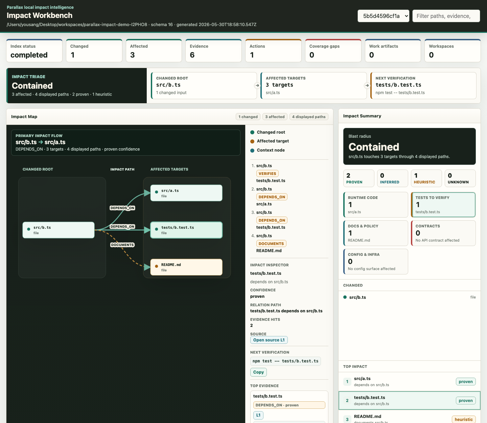

<div align="center">

# 🛰️ Parallax

**変更が何を壊しうるか、コーディングエージェントにローカルな地図を。**

Claude Code、Codex、Cursor などのエージェントがコードに手を加える前に、<br/>
リポジトリをローカルで索引化し、変更したファイルが影響しうるコード・テスト・ドキュメント・契約を根拠とともに示す、変更影響の分析ツールです。


[한국어](README.ko.md) · **日本語** · [English](README.md) · [中文](README.zh.md)

[🚀 クイックスタート](#-クイックスタート) · [✨ 機能](#-機能) · [🧱 基本概念](#-基本概念) · [🤖 MCP](#-mcp-とエージェント) · [🔒 安全性モデル](#-安全性モデル) · [🗺️ ロードマップ](#%EF%B8%8F-ロードマップ) · [📚 関連ドキュメント](#-関連ドキュメント)



</div>

---

> **開発の背景** — AI コーディングツールは高速ですが、`auth.ts` の関数を 1 つ変更するたびに、どのテスト・利用側コード・ポリシー文書が一緒に変わるのかを推測しなければなりません。Parallax はコードのグラフとエージェントのメモリをリポジトリ内の `.parallax/impact.db` に保存します。エージェントは変更に着手する*前に*、小さなコンテキストパックで「何が、なぜ影響を受けるのか」を確認できます。

---

## 🚀 クイックスタート

### 要件

| 項目 | 要件 | 補足 |
| :--- | :--- | :--- |
| **Node.js** | `>=24.0.0` | 組み込みの `node:sqlite` を使用するため、実験的機能の警告が表示される場合があります |
| **npm** | package-lock に準拠 | `npm ci` で開発環境を準備します |
| **リポジトリの権限** | ローカルの読み書き | `.parallax/` ディレクトリと SQLite DB を作成します |
| **外部サービス** | 主要な影響分析経路では不要 | モデル/LLM によるメモリ整理は、明示的に呼び出した場合だけ実行されます |

```bash
# 1. Build Parallax
git clone https://github.com/YouSangSon/Parallax.git
cd Parallax
npm ci
npm run build

# 2. Link the current checkout's CLI onto your PATH
npm link

# 3. Initialize and index inside the target repo
cd /path/to/target-repo
parallax init
parallax index
```

変更したファイルを 1 つ分析します。

```bash
parallax analyze --changed src/auth/session.ts --depth 2
```

Git の差分範囲を直接分析することもできます。

```bash
parallax analyze --base main --head HEAD
```

Markdown レポートはリポジトリ内の次のパスに保存されます。

```text
.parallax/reports/
```

機械可読な標準出力だけが必要な場合は `--json` を使用します。JSON 出力は保存されません。

GitHub Code Scanning では、SARIF を生成し、ワークフローからアップロードします。

```yaml
permissions:
  contents: read
  security-events: write
steps:
  - uses: actions/checkout@v4
    with:
      fetch-depth: 0
  - uses: YouSangSon/Parallax@main
    with:
      base: ${{ github.event.pull_request.base.sha }}
      head: ${{ github.event.pull_request.head.sha }}
      sarif-output: parallax.sarif
      sarif-category: parallax-pr
      fail-on: none
  - uses: github/codeql-action/upload-sarif@v3
    with:
      sarif_file: parallax.sarif
      category: parallax-pr
```

このアクションは `parallax init`、`parallax index`、`parallax pr triage` を実行し、SARIF ファイルを生成して、トリアージの要約を GitHub のステップサマリーに追記します。SARIF のアップロードはワークフロー側で行うため、`security-events: write` の指定を明示的に維持できます。

検出結果がある場合もアップロードステップを実行できるよう、SARIF の生成では失敗させない設定にします。確度の高い影響で CI を失敗させたい場合は、アクションの `fail-on` 入力を `proven` にするか、別のゲートステップとして `parallax analyze ... --fail-on proven` を追加します。

コミットやプッシュの前にも同じ影響ゲートを使う場合は、ローカルの Git フックをインストールします。

```bash
parallax install-hook --hook pre-commit --fail-on proven
parallax install-hook --hook pre-push --fail-on proven
parallax install-hook --hook all --dry-run
```

インストーラーが書き込むのは有効な Git フックディレクトリだけです。`core.hooksPath` に従い、`--force` が指定されていない限り既存の Parallax 以外のフックをスキップします。`PARALLAX_SKIP_HOOK=1` または Git の `--no-verify` でフックを回避できます。

最新のレポートをローカル UI で開きます。

```bash
parallax ui
parallax ui --report <report-id> --port 3717
```

UI は、選択した影響経路・フィルター・ポリシープリセットを URL に保持します。ツールバーから現在のワークベンチを JSON、影響を受けるパスの CSV、影響マップの PNG/SVG としてエクスポートできます。

`parallax index` の実行後、SCIP インデクサーが出力した `index.scip` ファイルを読み込むと、SCIP による高精度な情報を追加できます。

```bash
parallax scip import --file index.scip

# Pre-rendered JSON from the official SCIP CLI is also accepted:
scip print --json index.scip > index.scip.json
parallax scip import --file index.scip.json

# Export Parallax's latest completed index as SCIP-compatible JSON:
parallax scip export --file index.scip.json
```

インポーターは、直近で完了した Parallax の索引実行に、SCIP 由来の定義・参照エッジを追加します。バイナリの `index.scip` のインポートでは `PATH` 上の公式 `scip` CLI を使用します。JSON のインポートとエクスポートには、実行時の CLI は不要です。`--file` で明示的に選択するファイルは、信頼できる任意のローカルファイルを指定できます。既存の索引済みファイルのメタデータを維持し、実行中のドキュメントパスの競合を避けるため、ドキュメント本文は SCIP の `Document.text` または当該実行で記録したクリーンな Git コミットだけから取得します。本文がなくても最新の索引にすでに存在するドキュメントは、シンボルのみの根拠としてインポートします。本文がなく、索引にも存在せず、検証できないドキュメントは警告とともにスキップします。

UI から MCP、CI ガードレールまで進めるチュートリアルは、[`docs/getting-started.md`](docs/getting-started.md) を参照してください。

> 💡 `analyze` は影響を受けるファイルがある場合、終了コード `1` を返します。CI やエージェントのガードレールが「影響あり」をシグナルとして使えるようにするための、意図した動作です。

---

## ✨ 機能

### 🔎 影響分析

| 機能 | 動作 |
| :--- | :--- |
| **ローカル索引** | ファイル・エンティティ・関係・根拠・カバレッジを `.parallax/impact.db` に保存します |
| **変更分析** | 探索範囲を制限した複数ホップのグラフ探索で、`--changed` または `--base/--head` の入力を分析します |
| **根拠を重視したレポート** | `changed`、`affected`、`actions`、`evidence`、`adapterInsights`、`warnings` を JSON/Markdown で出力します |
| **関連テストの推定** | インポート・ファイル名の規約・アダプターの根拠から、影響を受ける可能性のあるテストを提案します |
| **検証計画** | 推奨アクションを順位付きのリポジトリマップコマンドにまとめ、対象となる変更パス・影響パス・実行対象パスを示します |
| **グラフのエクスポート** | 保存したレポートを Mermaid、JSON、DOT でエクスポートします |
| **カバレッジの警告** | サイズ上限によるファイルのスキップ、古い索引、アダプターの既知の未対応範囲をレポートに表示します |

### 🧭 アダプターの対応範囲

| 領域 | 現在の状態 |
| :--- | :--- |
| **TypeScript / JavaScript** | パーサーに基づくインポート・宣言・クラス/インターフェースの継承関係・呼び出し箇所・型付き/分割代入/名前付きオブジェクトのレシーバー・ファクトリーの戻り値・コンストラクター/フィールド呼び出しの範囲を拡充中です |
| **JVM / Spring Boot** | エンドポイント・宣言・設定・テストの根拠範囲 v0 |
| **Python / Go / Rust** | 宣言とテストの関係を中心とする軽量アダプター |
| **Markdown / 作業成果物** | ポリシー・提案・PRD・意思決定文書を第一級の成果物として分類し、コードに関連付けます |
| **設定 / インフラ** | shell、YAML、JSON、TOML、Dockerfile、Makefile、Terraform、CODEOWNERS などのシステム/設定候補を索引化します |
| **パッケージマニフェストとロックファイル** | `package.json`、`pom.xml`、`build.gradle(.kts)`、`go.mod`、`Cargo.toml`、`pyproject.toml` のマニフェストグラフに加え、npm の `package-lock.json`、`Cargo.lock`、`poetry.lock` の推移的依存関係に対応します |
| **SCIP のインポート/エクスポート** | `parallax scip import --file <index.scip or index.scip.json>` は最新の索引に SCIP の定義・参照エッジを追加し、`parallax scip export --file <index.scip.json>` は SCIP 互換の JSON を出力します |

### 🌐 ワークスペースと契約

| 機能 | 説明 |
| :--- | :--- |
| **ワークスペースカタログ** | ユーザーが `.parallax/workspace.json` で許可したローカルリポジトリ、明示したパッケージディレクトリ、検出した npm/pnpm ワークスペースパッケージ、Nx プロジェクト設定だけを登録します。クローンやネットワークアクセスは行いません |
| **リポジトリ横断リゾルバー** | 登録済みリポジトリ間で、提供側エンドポイント ↔ 利用側ファイルの関連を保存します |
| **契約の差分** | OpenAPI、GraphQL、Protobuf、AsyncAPI、JSON Schema、Avro の公開インターフェースの差分を `breaking` / `non-breaking` / `unknown` に分類します。OpenAPI のレスポンスの任意プロパティ削除・nullable 追加・format/enum 変更、リクエストの format 追加/変更・enum 値削除、JSON Schema のルートオブジェクト変更、Avro のトップレベルレコードのフィールド変更も対象です |
| **利用側への影響** | 破壊的なエンドポイント/操作の削除、必須フィールドの削除、型/nullable/format/enum の変更、リクエストの必須フィールド追加、リクエストの format 追加/変更、リクエストの enum 値削除を、既知の利用側に関連付けます |
| **イベントトポロジーのヒント** | AsyncAPI の producer/consumer の方向と破壊的変更の由来を、コンパクトなペイロードで提供します |

```bash
parallax workspace init --name platform --service api
parallax workspace discover-packages --name platform --json
parallax workspace add-repo ../web --name platform --service web
parallax workspace resolve-contracts --name platform --json
parallax workspace contract-diff --contract openapi.yaml --name platform --json
```

### 🧠 エージェントメモリ

エージェントの意思決定・観測・理由を、内容に基づいてアドレス指定できるファクトとして同じ SQLite DB に保存します。

| コマンド | 役割 |
| :--- | :--- |
| `remember` | エンティティについての意思決定/観測ファクトを保存します。`--supersedes-fact-ids` で古いファクトを置き換えます |
| `recall` | エンティティ・属性・キーワード・意味検索でファクトを照会します |
| `branch` / `merge` | データをコピーせずに複数の計画を分岐/統合します |
| `trace` | `fact_provenance` エッジをたどり、意思決定に至る推論の連鎖を追跡します |
| `profile` | エンティティの静的ファクト・動的ファクト・要約ファクトをまとめて返します |
| `reflect` | LLM で古いファクトを要約し、要約ファクトに昇格させます |

```bash
parallax remember --entity src/auth/session.ts \
  --attribute decision --value "Allow JWT clock skew of 60s"
parallax recall --entity src/auth/session.ts --json
parallax profile --entity src/auth/session.ts
```

---

## 🧱 基本概念

| 概念 | 説明 |
| :--- | :--- |
| **影響グラフ** | ファイル/シンボル/契約をつなぐ有向グラフ。範囲を制限した探索で変更の波及を計算します |
| **根拠** | すべての関係に、裏付けとなるソースファイル・行・スニペットを付けます |
| **確度** | 根拠の確度を proven / inferred / heuristic / unknown で示します |
| **コンテキストパック** | エージェントが扱いやすい小さな JSON バンドルとして、変更分析の結果を渡します |
| **作業成果物** | ポリシー・PRD・意思決定などの文書をコードに結び付ける第一級のオブジェクト |
| **アダプター** | 確度と既知の未対応範囲を報告する、言語/形式ごとの抽出器 |

---

## 🤖 MCP とエージェント

Parallax は MCP stdio サーバーを提供します。

```bash
parallax mcp serve
```

| MCP ツール | 役割 |
| :--- | :--- |
| `parallax_analyze_diff` | 変更ファイルを受け取り、影響レポートを返します |
| `parallax_context_for_change` | 変更について、予算内に収まるコンテキストパックを返します |
| `parallax_search_context` | 最新の索引をキーワード/パス/シンボル/関係/根拠で検索します |
| `parallax_contract_diff` | 対応する契約を、索引済みワークスペースの基準状態と比較します |
| `parallax_remember` / `parallax_recall` | エージェントメモリのファクトを書き込み/読み出しします |
| `parallax_profile` / `parallax_trace` | エンティティのプロファイルと推論の連鎖を照会します |

登録されたツールは MCP のツールインターフェースから利用できます。グラフのエクスポートはツールではなく MCP の**リソース**です。`parallax://reports/{reportId}/graph/{format}`（`mermaid`、`json`、`dot`）を読み取ります。

> Claude Code や Codex などの MCP クライアントに stdio サーバーとして登録すれば利用できます。

---

## 🔒 安全性モデル

| 原則 | 詳細 |
| :--- | :--- |
| **ローカル優先** | 主要な index/analyze 経路はリポジトリ内の `.parallax/` にデータを保存します。任意のモデルダウンロードや、設定したリフレクションプロバイダーはネットワークを使用する場合があります |
| **明示的なワークスペース** | リポジトリ横断の対象は、ユーザーが登録したローカルリポジトリまたはパッケージディレクトリだけです。クローンやネットワークアクセスは行いません |
| **秘匿情報のマスキング** | シークレットらしい文字列は保存前にマスキングします |
| **ソースツリーは既定で読み取り専用** | MCP はソースファイルを編集しません。分析/検索ツール、コンテキストパックの再利用、MCP リソースの読み取りでは、`.parallax/impact.db` にコンテキストパックやテレメトリの行を追加する場合があります。明示的なメモリコマンドはファクトを書き込みます |
| **再現可能なコア** | オフラインのフィクスチャで静的な影響分析結果を検証します。生成される ID/タイムスタンプとモデルを使うメモリは、バイト単位の再現性の対象外です |

---

## 🧪 開発

```bash
npm run build
npm run check
npm test
npm run docs:lint
```

主なスクリプト:

| スクリプト | 役割 |
| :--- | :--- |
| `npm run build` | TypeScript を `dist/` にコンパイルします |
| `npm run check` | 出力を生成せず型チェックを行います |
| `npm test` | `tsx` 経由で Node テストランナーのスイートを実行します |
| `npm run bench` | 多言語・Spring Boot・契約・共変更・トレース・パッケージマニフェストのフィクスチャに対し、決定的なベンチマークを実行します |
| `npm run docs:lint` | 追跡済み/未追跡の Markdown について、禁止内容、4 言語 README の整合性、3 言語ガイドの整合性、同一言語のリンク、ローカル `.md` リンク先の欠落を確認します |
| `npm run verify` | ソースチェックアウトのリリースゲート全体を実行します |
| `npm run test:mcp` | MCP の影響分析/コンテキスト/メモリ/テレメトリ/パス検証を確認します |
| `npm run test:security` | パスが許可範囲内に収まることと、秘匿情報のマスキングを検証します |
| `npm run test:ui` | ローカル UI のスナップショット、サーバー、JSON リソースエンドポイントを検証します |
| `npm run test:dogfood` | Parallax 自身を索引化し、内部の依存グラフが維持されることをアサートします（[`docs/verification.md`](docs/verification.md) を参照） |

ソースチェックアウトのリリースゲート全体:

```bash
npm run verify
```

`npm run verify` は、ソースチェックアウトでリリース前に実行する標準コマンドです。lint、インストールスモークテスト（唯一のビルドを担当）、高速テストスイート、dogfood、ベンチマーク、上位レベルの監査を実行します。

---

## 🗺️ ロードマップ

| 領域 | 次の目標 |
| :--- | :--- |
| **精度** | パーサーに基づく TS/JS の範囲を、より広い動的ディスパッチと高度な型関係へ拡張します |
| **JVM / Python / Go / Rust** | 宣言中心のアダプターを、パーサーに基づく呼び出し/インポート解決へ発展させます |
| **ワークスペース / 契約** | ネストしたスキーマの差分を安定させ、生成クライアント/イベントトポロジーのリゾルバーを拡充します |
| **パッケージ / ビルド** | npm/Cargo/Poetry のロックファイル対応を他のエコシステムと semver/範囲の影響へ拡張します |
| **エージェント向けインターフェース** | コンテキストパックの予算調整と、ヒット/ミスの測定ハーネス |
| **UI Explorer** | 変更 → 影響 → 根拠 → アクションの流れを、1 画面でより直接的に探索できるようにします |
| **測定** | フィクスチャのベンチマーク差分と、検索品質の回帰検出 |

詳細なバックログは [`docs/roadmap.md`](docs/roadmap.md) で管理しています。

---

## ⚠️ 現在の制限

| 領域 | 状態 |
| :--- | :--- |
| **完全な意味解析** | すべての言語で型を考慮した解析を行うわけではありません。各アダプターの確度と既知の未対応範囲を確認してください |
| **契約の深さ** | GraphQL/Protobuf/AsyncAPI のパーサー/LSP レベルでの完全な生成クライアント利用グラフと、Avro の完全な名前付き型/スキーマレジストリ解決は今後の課題です |
| **パッケージ解決** | npm の `package-lock.json`、`Cargo.lock`、`poetry.lock` の推移的依存関係を索引化します。他のロックファイルのエコシステム、semver の影響、実行に基づくリゾルバーは今後の課題です |
| **グラフ DB** | 既定の製品範囲には含みません。必要に応じて SQLite からの任意の投影として拡張できます |
| **外部への書き込み** | Obsidian/GitHub/Jira への書き込み同期は、まだ MCP インターフェースで公開していません |
| **コードの変更** | Parallax はコードを直接変更せず、エージェントに影響と根拠を提供します |

---

## 📚 関連ドキュメント

詳細ガイドは現在、英語・韓国語・中国語で提供しています。以下は英語版へのリンクです（ドキュメント索引は日本語版）。

| ドキュメント | 内容 |
| :--- | :--- |
| [`docs/vision.md`](docs/vision.md) | プロジェクトのビジョン |
| [`docs/value-proposition.md`](docs/value-proposition.md) | 提供価値と差別化 |
| [`docs/roadmap.md`](docs/roadmap.md) | 現在のバックログと次の実装単位 |
| [`docs/invariants.md`](docs/invariants.md) | ローカル優先、秘匿情報のマスキング、権限モデルなどの不変条件 |
| [`docs/glossary.md`](docs/glossary.md) | 用語集 |
| [`docs/README.ja.md`](docs/README.ja.md) | ドキュメント索引 |
| [`docs/getting-started.md`](docs/getting-started.md) | init から MCP、CI ガードレールまでの初回実行チュートリアル |
| [`docs/architecture.md`](docs/architecture.md) | ソースチェックアウトの実行時アーキテクチャと拡張マップ |
| [`docs/mcp.md`](docs/mcp.md) | MCP サーバー、ツール、リソース |
| [`docs/cli-reference.md`](docs/cli-reference.md) | すべての CLI コマンド、フラグ、終了コード |
| [`docs/report-schema.md`](docs/report-schema.md) | `analyze --json` 出力の公開 JSON Schema |
| [`docs/extending-adapters.md`](docs/extending-adapters.md) | 意味解析アダプターの作成 |
| [`docs/verification.md`](docs/verification.md) | 検証レイヤー、テストスクリプト、dogfood ガード |
| [`docs/operations.md`](docs/operations.md) | トラブルシューティングと運用手順 |
| [`docs/release-checklist.md`](docs/release-checklist.md) | ソースチェックアウトのリリース、CI、監査、パッケージスモークテストのチェックリスト |

---

## ライセンス

MIT License。詳細は [`LICENSE`](LICENSE) を参照してください。
